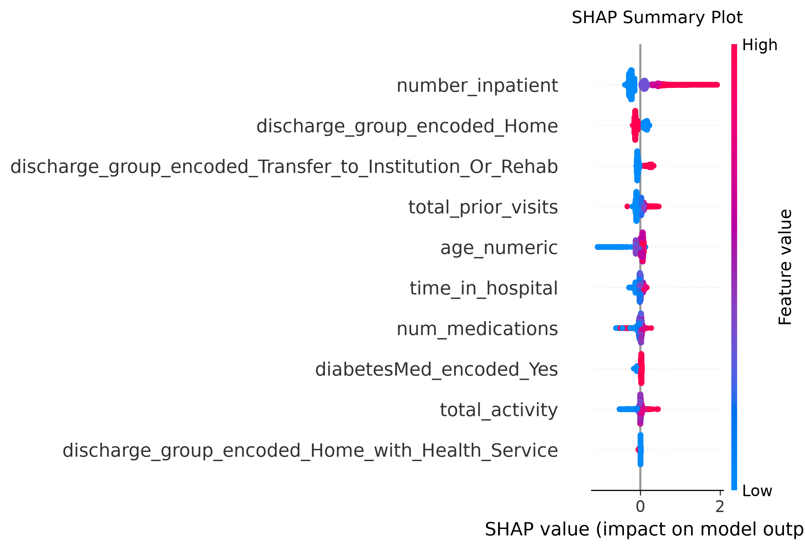
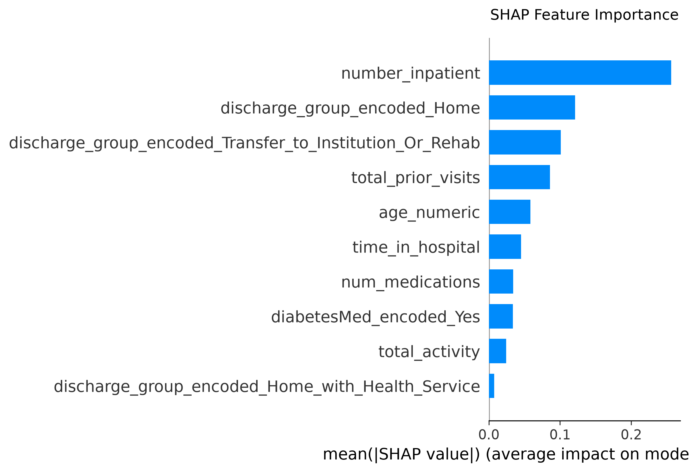

# 📊 XGBoost Model Evaluation Report

## 1. Global Performance Metrics
- **ROC AUC:** `0.6661`
- **Accuracy:** `0.6625`
- **Macro F1-Score:** `0.5283`

---

## 2. Classification Metrics by Class
| Class | Precision | Recall | F1-Score | Support |
| :--- | :--- | :--- | :--- | :--- |
| **0 (No Readmission)** | 0.9252 | 0.6741 | 0.7799 | 17626.0 |
| **1 (Readmitted <30 Days)** | 0.1825 | 0.5716 | 0.2766 | 2243.0 |

---

## 3. Confusion Matrix Breakdown
- **True Negatives (TN):** `11882`
- **False Positives (FP):** `5744`
- **False Negatives (FN):** `961`
- **True Positives (TP):** `1282`

---
## 4. Model Interpretability (SHAP Analysis)
Plots below show the global and directional impact of features on the model's decisions:

### Summary Plot (Directional Impact)

### Feature Importance (Global Importance)

