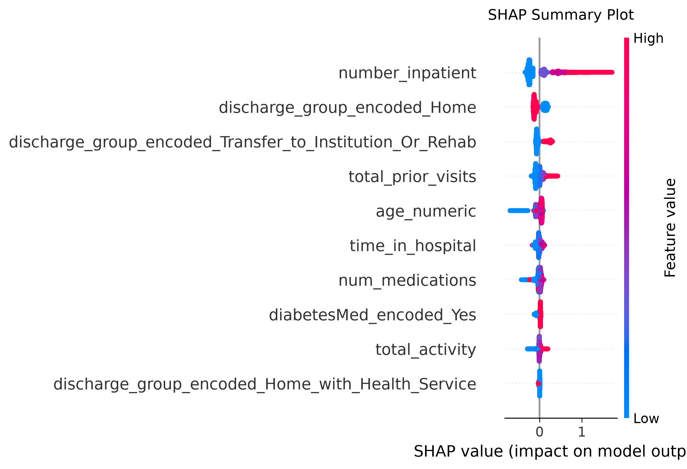
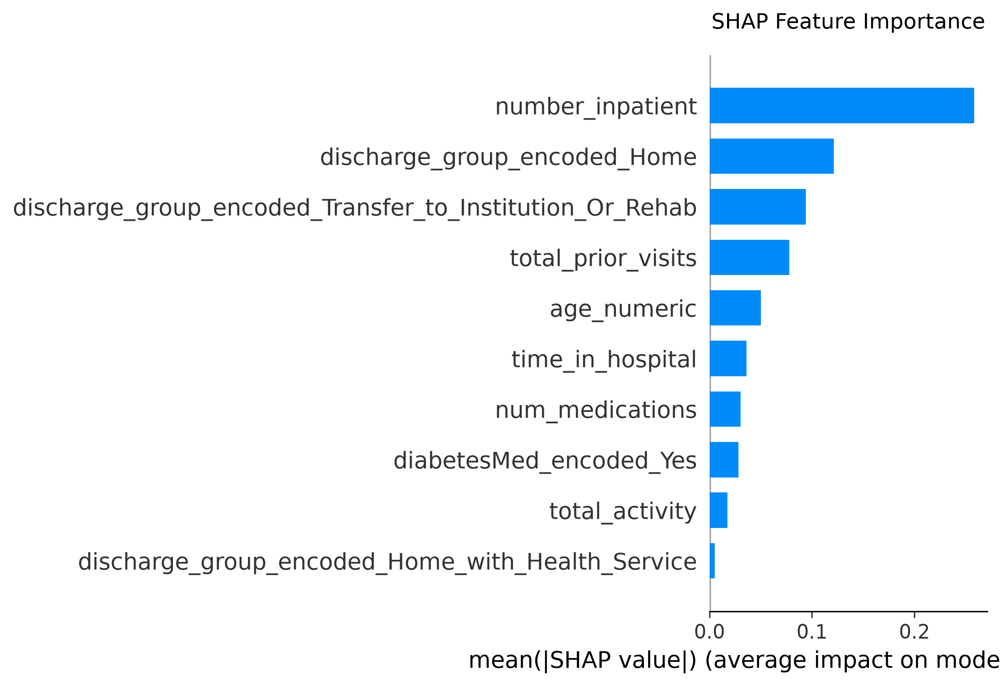

# 📊 XGBoost Model Evaluation Report

## 1. Global Performance Metrics
- **ROC AUC:** `0.6652`
- **Accuracy:** `0.6954`
- **Macro F1-Score:** `0.5416`

---

## 2. Classification Metrics by Class
| Class | Precision | Recall | F1-Score | Support |
| :--- | :--- | :--- | :--- | :--- |
| **0 (No Readmission)** | 0.9209 | 0.7183 | 0.8071 | 17626.0 |
| **1 (Readmitted <30 Days)** | 0.1887 | 0.5149 | 0.2762 | 2243.0 |

---

## 3. Confusion Matrix Breakdown
- **True Negatives (TN):** `12661`
- **False Positives (FP):** `4965`
- **False Negatives (FN):** `1088`
- **True Positives (TP):** `1155`

---
## 4. Model Interpretability (SHAP Analysis)
Plots below show the global and directional impact of features on the model's decisions:

### Summary Plot (Directional Impact)

### Feature Importance (Global Importance)

